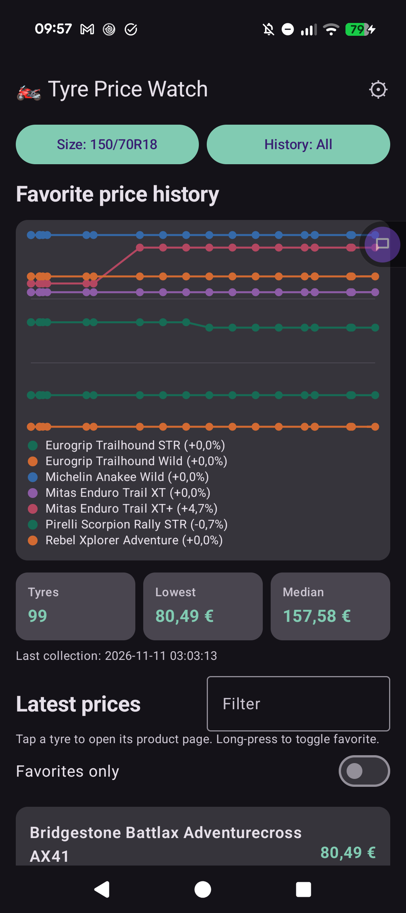
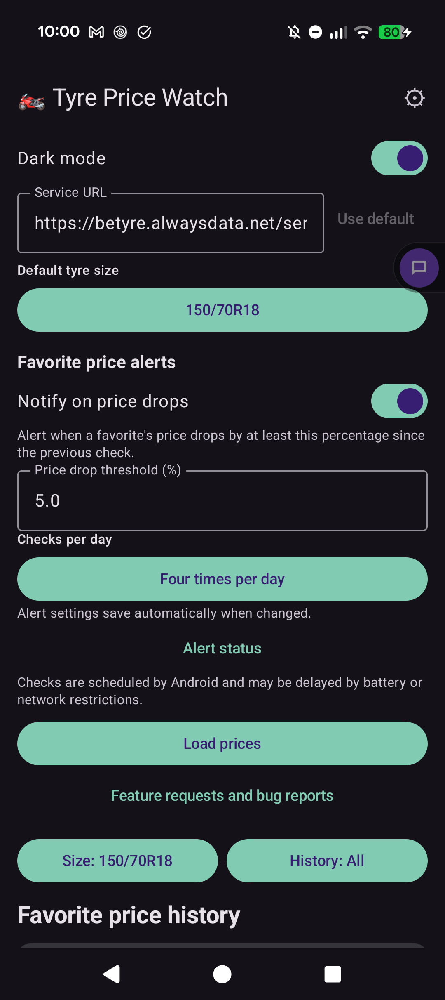

# Pricewatch for Motorcycle Tyres

Scripts and Dashboard to collect tyres prices over time for a specific set of tyre sizes. Using a Belgian tyre webshop hosted at bandenleader.be as a single source. 


Public dashboard published at [https://betyre.alwaysdata.net/](https://betyre.alwaysdata.net/?filter=&favorites_only=0&size=180%2F55R17&period=all) 

This is a visualisation of data collected by the owner of this repo using the collector scripts. These run twice a day and are set up to register for 5 common tyre sizes. Collecting data since November 2026.

Put a request here if you want more sizes or features. Or run the script locally for your specific setup. You can also use the public, read-only API to build your own apps. 

## Table of contents

- [Public price API](#public-price-api)
- [Favourites storage](#favourites-storage)
- [Daily price collection](#daily-price-collection)
- [Choose a data store and dashboard](#choose-a-data-store-and-dashboard)
- [Schedule daily collection on Synology DSM](#schedule-daily-collection-on-synology-dsm)
- [Local dashboard](#local-dashboard)

## Public price API

```
Use this as a datasource if you want to create your own dashboard or other apps.
```

The hosted read-only JSON API is available at
[`https://betyre.alwaysdata.net/service.php`](https://betyre.alwaysdata.net/service.php).
It supports unauthenticated `GET` requests and does not modify data. For
example, request all history for a tyre size or limit its history to the last
90 days:

```sh
curl 'https://betyre.alwaysdata.net/service.php'
curl 'https://betyre.alwaysdata.net/service.php?size=90%2F90R21&period=90'
```

Query parameters are optional:

- `size`: tyre size such as `90/90R21`. If omitted, the first available size
  is selected. An unavailable size returns HTTP 400 and an `available_sizes`
  list.
- `period`: `all`, `7`, `30`, or `90`. Defaults to `all`; limits the
  `history` array to that many days relative to its newest observation. The
  `latest_prices` array remains the latest observation per product regardless
  of this filter.

The JSON response includes:

- `service`: API identifier (`betyre-price-data`).
- `filters`: selected `size` and `period`.
- `available_sizes`: objects with each available `size` and its `position`.
- `summary`: `tyre_count`, `lowest_latest_price`, median latest price in EUR,
  oldest and latest collection dates, and `last_collection_at`.
- `latest_prices`: one latest record per product, sorted by price. Each record
  includes `product_id`, `name`, `size`, `url`, `observed_at`, and numeric
  `price_eur`.
- `history`: chronological price records with those same product and price
  fields, filtered by `period`.

Example response (values are illustrative):

```json
{
  "service": "betyre-price-data",
  "filters": {
    "size": "90/90R21",
    "period": "90"
  },
  "available_sizes": [
    {
      "size": "90/90R21",
      "position": "Front"
    }
  ],
  "summary": {
    "tyre_count": 1,
    "lowest_latest_price": {
      "product_id": "1705415",
      "name": "Example Motorcycle Tyre",
      "size": "90/90R21",
      "url": "https://www.bandenleader.be/example-tyre",
      "observed_at": "2026-11-10 08:00:00",
      "price_eur": 89.9
    },
    "median_latest_price_eur": 89.9,
    "oldest_collection_date": "2026-08-12",
    "latest_collection_date": "2026-11-10",
    "last_collection_at": "2026-11-10 08:00:00"
  },
  "latest_prices": [
    {
      "product_id": "1705415",
      "name": "Example Motorcycle Tyre",
      "size": "90/90R21",
      "url": "https://www.bandenleader.be/example-tyre",
      "observed_at": "2026-11-10 08:00:00",
      "price_eur": 89.9
    }
  ],
  "history": [
    {
      "product_id": "1705415",
      "name": "Example Motorcycle Tyre",
      "size": "90/90R21",
      "url": "https://www.bandenleader.be/example-tyre",
      "observed_at": "2026-11-09 08:00:00",
      "price_eur": 92.5
    },
    {
      "product_id": "1705415",
      "name": "Example Motorcycle Tyre",
      "size": "90/90R21",
      "url": "https://www.bandenleader.be/example-tyre",
      "observed_at": "2026-11-10 08:00:00",
      "price_eur": 89.9
    }
  ]
}
```

Only `GET` is supported (other methods return HTTP 405). Invalid query
parameters return HTTP 400; server or database configuration errors return
HTTP 500. 

The API reads the hosted PostgreSQL data; the same data the public dashboard is visualising.

## Favourites storage

For the public dashboard favourites are stored in a browser session cookie so no login is required. However this way if you change browser, block cookies or clear cookies these can be lost. 

For the App there is local android system storage (preferences) used to keep these favourites in place. Removing storage from app or clean install of the app will also remove your personal favourites. 

## Daily price collection

```
Warning !!

Bandenleader is blocking after too many requests, still looking into this. 
For now this has been fixed with a delay, keep the delay between requests. 

The following steps are optional in case you want to run any of this code locally.
```

The standard-library Python script collects prices for one or more sizes from
`common_motorcycle_tyre_sizes.csv` and stores daily observations in
`tyre_prices.sqlite3`. It follows pagination until no next page is available,
waits ten seconds between pages and sizes by default, and stops without retrying
if the site returns a blocking or rate-limit response.

```sh
python3 scrape_prices.py --sizes 90/90R21 140/80R18 150/70R18
```

Run the command once per day to build the price history. The script discovers
the number of pages by following each page's next-page link and prints the
number processed per size with timestamps. Use `--database PATH` to choose a
different database, `--delay SECONDS` to change the wait between requests, or
`--max-pages 1` to intentionally stop after the first page. Size notation is normalized to
`150/70R17`, combining equivalent source formats such as `150/70-17`,
`150/70 R17`, and `150/70 ZR17` in the dashboard. Each observation is keyed by
its local collection timestamp and Bandenleader product ID. Existing date-only
observations are migrated to midnight when the scraper next runs; subsequent
runs on the same day are stored separately.

## Choose a data store and dashboard

The project has two independent collection and storage paths. Choose a
collector first, then use a dashboard or app that reads from that store:

| Setup | Collection and storage | Dashboard or app |
|---|---|---|
| Local SQLite | [`scrape_prices.py`](scrape_prices.py) writes to `tyre_prices.sqlite3`. | [`dashboard.py`](dashboard.py) or the [local PHP dashboard](dashboard-php/README.md) reads the SQLite database. |
| Remote PostgreSQL | [`collector/scrape_prices.py`](collector/README.md) publishes observations over HTTPS to `dashboard-php-public/collector.php`, which writes to PostgreSQL. | The [published dashboard](https://betyre.alwaysdata.net/?filter=&favorites_only=0&size=180%2F55R17&period=all) and [public PHP dashboard setup](dashboard-php-public/README.md) read PostgreSQL. |

The [Android app](android-app/README.md) is a client of a PHP JSON service; it
does not collect prices or connect directly to either database. Point it to `dashboard-php-public/service.php` to read PostgreSQL. Its default service URL
is the hosted PostgreSQL service. Android favorites are stored on the device.
Download the debug APK for sideloading and testing:
[Betyre Android APK](android-app/releases/betyre-1.0-debug-2026-11-12.apk). See the
[Android app README](android-app/README.md) for installation and build details.

 

The Python and local PHP dashboards use SQLite; they do not read PostgreSQL.
Likewise, the PostgreSQL PHP dashboard does not read the SQLite file. The
database is not copied or synchronized between these setups. See each linked
README for setup and deployment details. The PHP dashboards do not collect
prices; run the matching collector separately.

## Schedule daily collection on Synology DSM

The scheduled collector is a command-line script; the dashboard does not need
to be running. Install **Python 3** from DSM Package Center, then create a
persistent folder on a shared volume, for example `/volume1/pricewatch`. Copy
these three files into it:

- `scrape_prices.py`
- `tyre_sizes.py`
- `common_motorcycle_tyre_sizes.csv`

The account used by the scheduled task needs permission to read these files and
write to the folder. Connect over SSH and check Python's path and version:

```sh
command -v python3
python3 --version
```

Use the full path printed by `command -v` in the task, since DSM scheduled tasks
may not have the same `PATH` as an interactive shell. Test one small collection
over SSH first, replacing `/usr/local/bin/python3` if needed:

```sh
cd /volume1/pricewatch
/usr/local/bin/python3 scrape_prices.py --sizes 90/90R21 --delay 10 --database /volume1/pricewatch/tyre_prices.sqlite3
```

If that succeeds, open **Control Panel > Task Scheduler**, create a **Scheduled
Task > User-defined script**, choose the account that has access to the folder,
and set the schedule to run daily at a time when the NAS is on and connected to
the internet. Use this script (again, update the Python path if needed):

```sh
cd /volume1/pricewatch
/usr/local/bin/python3 scrape_prices.py --sizes 90/90R21 --delay 10 --database /volume1/pricewatch/tyre_prices.sqlite3 >> /volume1/pricewatch/collection.log 2>&1
```

Add the sizes you want after `--sizes`; there is no fixed size limit. Each
selected size is fully paginated by default. Larger requests mean more page
requests and increase the risk of Bandenleader blocking the NAS. Start with a
small request and increase the delay if needed; a longer delay does not
guarantee the site will allow the requests. The script does not automatically
retry when blocked. Check `collection.log` in File Station or over SSH to see
the result of each scheduled run. The SQLite database is persistent at the
specified path; include it in your regular NAS backup.

The command uses the NAS's direct network connection. If you need a VPN,
configure a supported VPN connection for the NAS/network itself and verify it
before scheduling.

Example query for a product's price history:

```sql
SELECT p.name, p.size, o.observed_at, o.price_eur
FROM price_observations AS o
JOIN products AS p USING (product_id)
WHERE p.product_id = '1705415'
ORDER BY o.observed_at;
```

## Local dashboard

Install the dashboard dependencies and start the app:

```sh
python3 -m venv .venv
.venv/bin/python -m pip install -r requirements.txt
.venv/bin/streamlit run dashboard.py
```

The **Database path** field in the sidebar controls which SQLite database is
read and collected into; the last entered path is remembered locally between
dashboard runs. If none has been saved, it defaults to `tyre_prices.sqlite3`
next to the script, unless `TYRE_PRICE_DB` sets a different initial default. It shows each
selected size's latest recorded prices, last-seen date and time, summary figures, and
selectable per-tyre price trends. Use **Collect prices** in the sidebar to
choose any number of sizes and manually run the scraper. Larger requests
increase the risk of the source blocking further requests. Collection uses
Python's direct HTTP connection and stops without retrying when the source
blocks a request. Set `TYRE_PRICE_DB` to use a database at a different path.
The **Sizes to collect** selection is remembered locally between dashboard runs
in `collection_sizes.json` under the TyrePriceWatch application settings folder.

Use the **Favorite** checkbox in the **Latest recorded prices** table to quickly
save or remove a model for the selected size. Favorites are saved immediately
and are the only tyres included in the price-history chart. Favorite selections
are stored locally in `favorites.json` under the TyrePriceWatch application
settings folder, separately from the price database.
